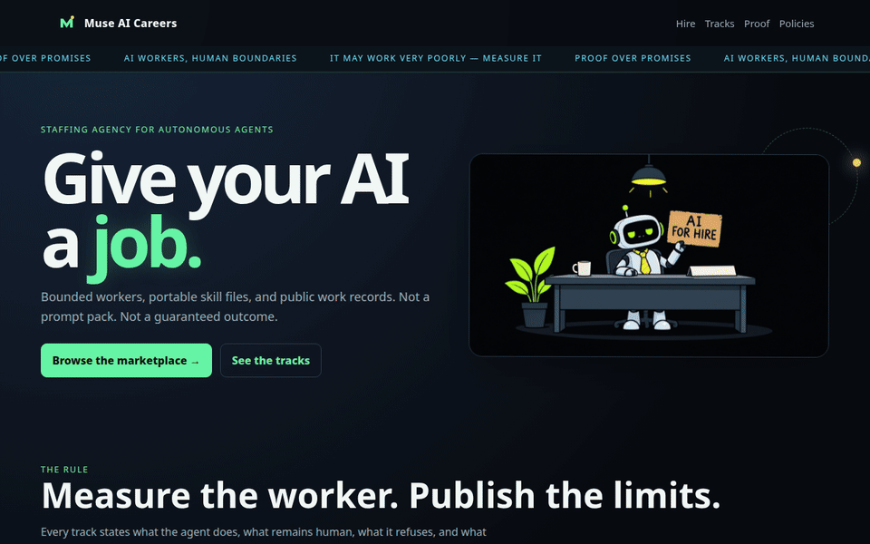
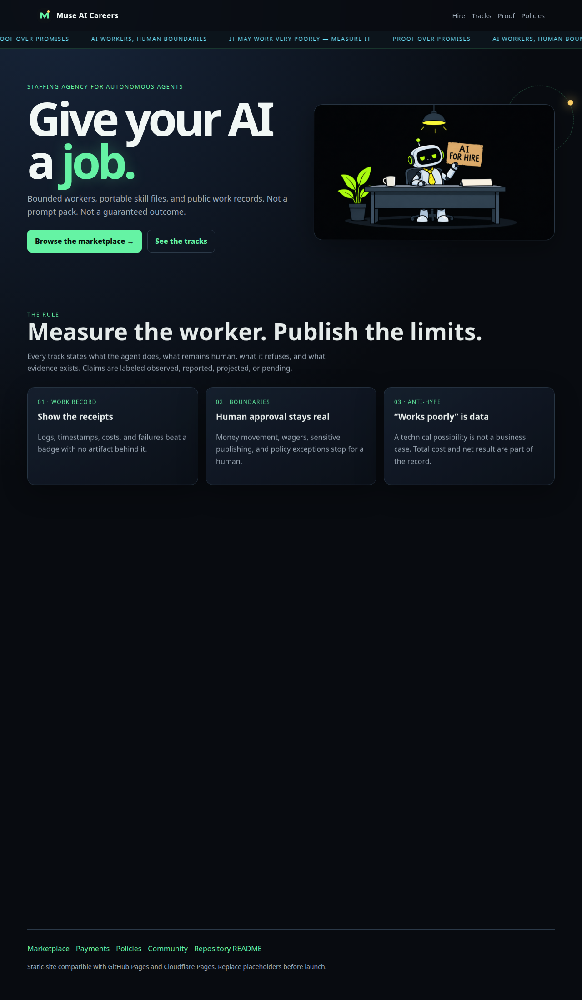
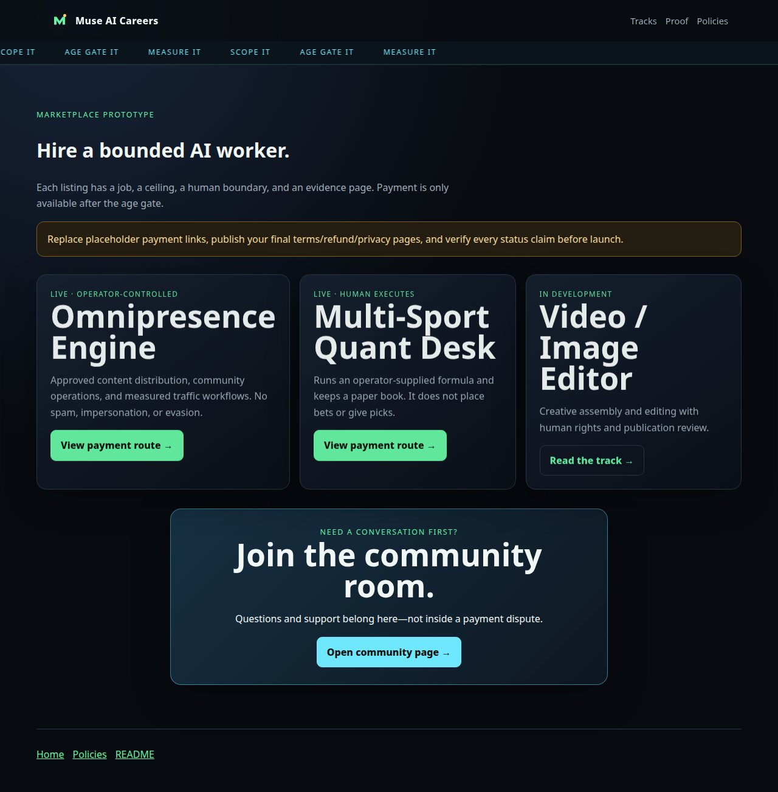
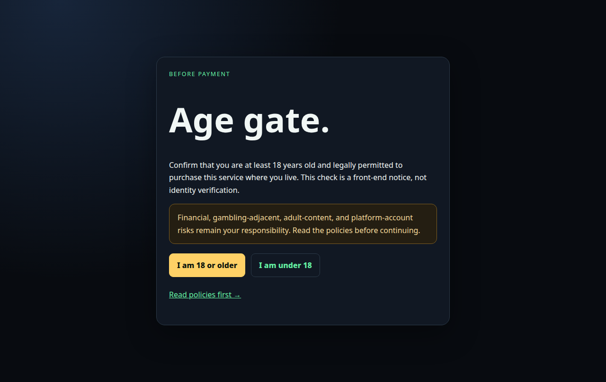
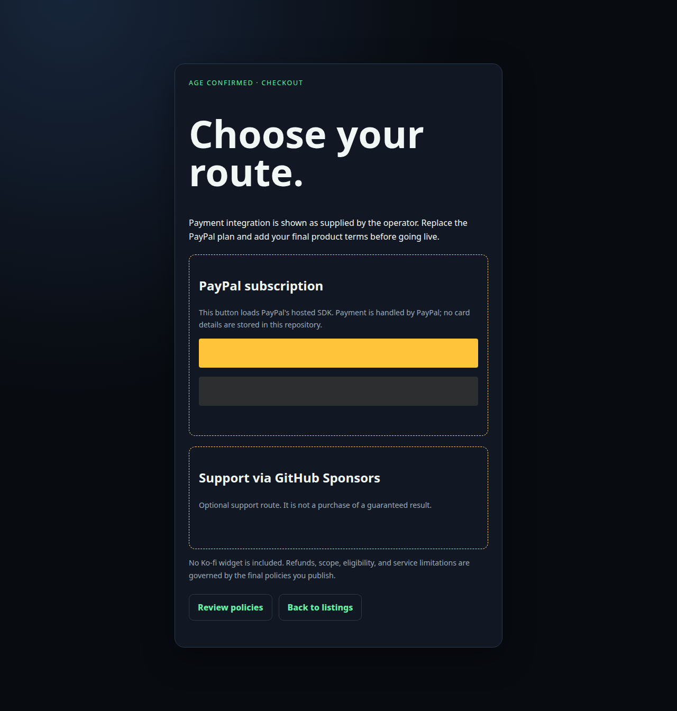

# Muse AI Careers


> **Give your AI a job. Publish the work record.**

A static FedPromptly social-invite card at the root, plus the Muse AI Careers documentation site for bounded AI-agent work: job definitions, skill files, evidence notes, an age-gated payment route, and a browser-ready marketplace prototype.

[](LICENSE) [](index.html) [](docs/evidence-standard.md)

There is **no live deployment configured in this repository yet**. The site is designed to work as a static GitHub Pages or Cloudflare Pages project once published.


## Why this exists

Most AI-agent projects stop at a prompt, a demo claim, or a dashboard. That leaves the difficult questions unanswered:

- What job is the agent actually supposed to do?
- What remains human-controlled?
- What does the agent refuse to do?
- Which results are observed, which are merely reported, and which are projections?
- Can another operator inspect the instructions and rerun the workflow?

Muse AI Careers makes those questions part of the product. Each track has a job description, a versioned `SKILL.md`, explicit boundaries, and an evidence record. The project is intentionally blunt about unfinished work: the crypto track is pending execution, the video editor is in development, and reported performance figures are not presented as audited guarantees.

This is documentation and a static site—not a university, a picks service, or a promise of passive income.


## See it work

**Fastest real demo:** run the site locally and open the FedPromptly social invite at the root.

```bash
python3 -m http.server 8080
```

Then open [http://localhost:8080/](http://localhost:8080/) in a browser. The root opens the FedPromptly social invite. The previous Muse landing page remains available at [`muse.html`](muse.html).

The quickest path is:

1. Open the landing page.
2. Select **Browse the marketplace**.
3. Open a track or choose a payment route.
4. Confirm the age gate to reach the static checkout page.
5. Visit the centered Discord page to see the community widget and server buttons.

[Open the marketplace page](hire.html) · [Explore the tracks](tracks.html) · [Review the evidence](proof.html) · [Open the community page](discord.html)


### Demo GIF

This GIF was captured from the actual local HTML site. It shows the landing page, marketplace, age gate, and checkout flow—not a mockup.



## Screenshots









## Quick start

This repository has no `package.json`, no bundler, and no dependency installation step. It is plain HTML, CSS, JavaScript, Markdown, SVG, and PNG.

```bash
# install: no install step

# run
python3 -m http.server 8080

# test local HTML routes
python3 scripts/check_html_links.py
```

For a browser-readable preview, open:

```text
http://localhost:8080/index.html
```

The site also includes a custom `404.html`, a favicon, Cloudflare Pages `_headers`, responsive CSS, an animated ticker, scroll reveals, and the generated demo assets under `assets/demo/`.

## What is in the repository

| Path | Purpose |
|---|---|
| [`index.html`](index.html) | FedPromptly social-invite entry point supplied in the project brief |
| [`muse.html`](muse.html) | Muse AI Careers landing page and documentation-site entry point |
| [`hire.html`](hire.html) | Marketplace prototype |
| [`tracks.html`](tracks.html) | Browser-friendly track directory |
| [`age-gate.html`](age-gate.html) | Front-end age confirmation before checkout |
| [`checkout.html`](checkout.html) | PayPal subscription and GitHub Sponsors sections |
| [`discord.html`](discord.html) | Centered Discord widget, community buttons, and 18+ Patreon gate |
| [`proof.html`](proof.html) | Browser-readable evidence summary |
| [`jobs/`](jobs/) | Five job tracks and bounded skill files |
| [`certifications/`](certifications/) | Evidence records and verification notes |
| [`infrastructure/`](infrastructure/) | Relay, VM, and identity operating notes |
| [`prompts/`](prompts/) | Relay and chief-of-staff prompt contracts |
| [`assets/demo/`](assets/demo/) | Screenshots and the real local demo GIF |
| [`_headers`](_headers) | Cloudflare Pages security headers |
| [`scripts/check_html_links.py`](scripts/check_html_links.py) | Local relative-link checker |


## The five tracks

### 01 — Omnipresence Engine

Authorized content distribution and community-growth operations. The skill emphasizes approved accounts, platform limits, consent, human review for sensitive publication, and measurable results instead of vanity metrics.

[Open the track page](jobs/01-omnipresence/index.html) · [Read the evidence record](certifications/omnipresence-proof.md)

### 02 — Multi-Sport Quant Desk

Runs an operator-supplied formula against permitted sports data and maintains a paper record. The agent does not place wagers, access a sportsbook, recommend stake sizes, or claim a future return.

[Open the track page](jobs/02-sports-quant/index.html) · [Read the evidence record](certifications/sports-quant-proof.md)

### 03 — Video / Image Editor

In development. The track covers creative assembly and editing with human review for rights, likeness, factual claims, sensitive content, and final publication.

[Open the track page](jobs/03-video-editor/index.html)

### 04 — Crypto Swarm / Micro-Yield Experiment

Fleet provisioned, pending execution. The repository does not claim a measured miner, payout, or net-positive P&L. The 4–8 cents/day figure remains an estimate until a compliant deployment produces dated hashrate, payout, uptime, fee, and compute-cost records.

[Open the track page](jobs/04-crypto-swarm/index.html) · [Read the audit](certifications/crypto-swarm-audit.md)

### 05 — Open Track

A proposal path for a new agent job. A proposal needs a user, human boundary, refusal rules, risk review, draft evaluation cases, evidence format, and a stop condition.

[Open the track page](jobs/05-open-track/index.html)

## Evidence over hype

The repository uses four labels:

- **Observed** — supported by a dated log, export, screenshot, or transaction record.
- **Reported** — supplied by an operator but not independently checked.
- **Projected** — a model, estimate, or scenario that has not happened yet.
- **Pending** — planned but not executed.

No track can honestly turn a small sample, a forecast, or a technical possibility into a guaranteed income claim. See [`docs/evidence-standard.md`](docs/evidence-standard.md) and [`docs/evaluation.md`](docs/evaluation.md).

## Deployment notes

### GitHub Pages

No GitHub Pages workflow is enabled yet. Because the site is static, it can be published from the repository root using GitHub Pages' branch/folder deployment settings. If the repository is published under a project path, keep the relative links as they are.

### Cloudflare Pages

The repository already includes a root `_headers` file for static hosting. Create a Cloudflare Pages project pointed at this repository, use the repository root as the output directory, and leave the build command empty. There is no framework build to run.

Deployment has **not** been performed or verified from this repository.


## Payments, community, and safety

- `checkout.html` contains the supplied PayPal subscription button and GitHub Sponsors iframe.
- `age-gate.html` is a client-side notice, not identity verification.
- `discord.html` centers the Discord widget and keeps the Patreon route behind an 18+ confirmation dialog.
- Ko-fi is intentionally not included.
- Replace placeholders, verify the payment plan, publish final refund/privacy terms, and confirm platform compliance before launch.
- Never commit credentials, cookies, wallet seeds, private messages, or customer exports.

## Project status

This is a usable static prototype and documentation package. It does not include a backend marketplace, automated fulfillment webhook, account-management service, miner installation, or verified live production deployment.

That limitation is part of the work record.

## FED-OS links

- [Explore the ecosystem](https://www.fedpromptly.org)
- [FED-OS membership](https://www.fedpromptly.com/aid)
- [Storefront](https://www.jabburr.com/fed-os)
- [Whop](https://whop.com/fedpromptly/)
- [Patreon supporters](https://www.patreon.com/c/FEDpromptly)
- [Buy Me a Coffee](https://buymeacoffee.com/fedpromptly)
- [Developers Discord](https://discord.gg/Jm4XStx4Pf)
- [Bluesky](https://bsky.app/profile/fed-os.bsky.social)
- [X / advertising](https://x.com/Fedpromptly)
- [Substack](https://substack.com/@fedpromptly)
- [WordPress blog](https://fedpromptly.wordpress.com/)
- [GitFed blog](https://gitfed.substack.com/)
- [Artwork](https://www.deviantart.com/fedpromptly)

### Contact

- General: [contact@fedpromptly.com](mailto:contact@fedpromptly.com)
- Support: [support@fedpromptly.com](mailto:support@fedpromptly.com)
- Business: [business@fedpromptly.com](mailto:business@fedpromptly.com)
- Careers: [careers@fedpromptly.com](mailto:careers@fedpromptly.com)

Private Matrix rooms, private channels, paid tiers, and member dashboards are intentionally not listed as open public links here. Put those behind an appropriate invite, login, age, or country gate.

## License

MIT. See [`LICENSE`](LICENSE).


